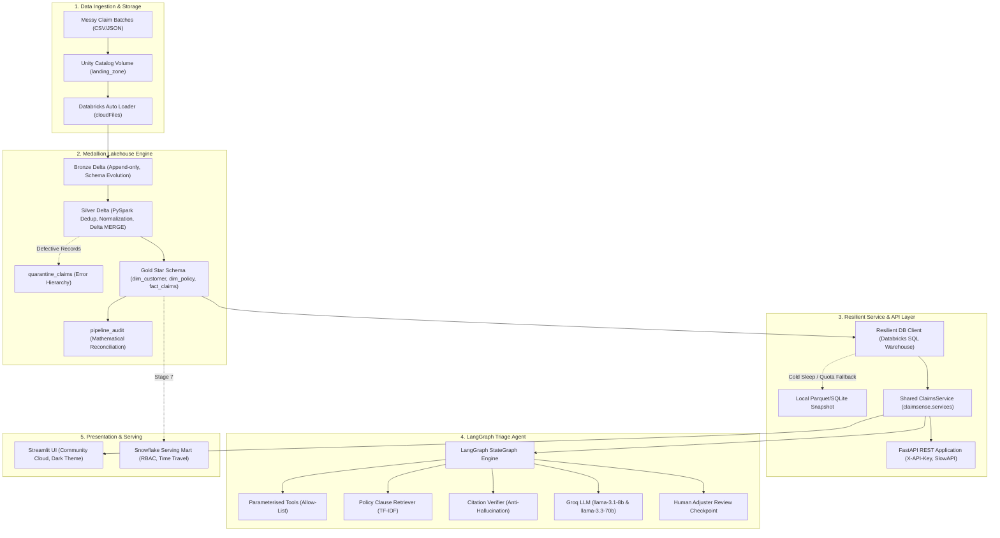
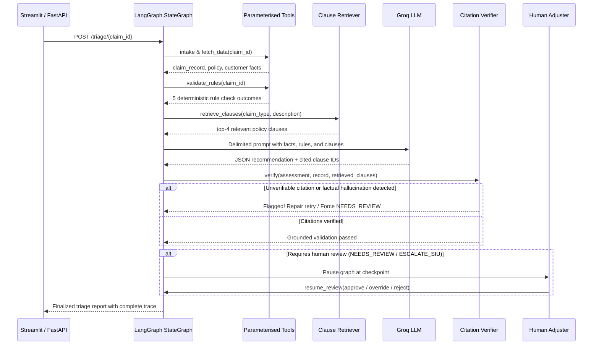

# ClaimSense Architectural Blueprint

ClaimSense is an enterprise-grade Insurance Claims Lakehouse & Anti-Hallucinating AI Triage Platform designed for reliable, auditable, and zero-cost operation.

---

## 1. High-Level Architecture Diagram

---

## 2. Medallion Layer Specifications

### Bronze Layer
* **Technology**: Databricks Auto Loader (`cloudFiles`), Delta Lake.
* **Characteristics**: Append-only, zero business transformation, automatic schema inference & tracking (`cloudFiles.schemaLocation`).
* **Metadata Enriched**: `_ingest_timestamp` (`TIMESTAMP`), `_source_file` (`STRING`).

### Silver Layer
* **Technology**: PySpark DataFrames, Delta Lake `MERGE INTO`.
* **Transforms**:
  * Window deduplication: `row_number() OVER (PARTITION BY claim_id ORDER BY reported_date DESC, _ingest_timestamp DESC) = 1`.
  * Type casting: Currency to `DECIMAL(12,2)`, dates to `DATE`.
  * Status normalization: String trim, casing standardization (`APPROVED`, `IN_REVIEW`, `SUBMITTED`, etc.).
  * Referential integrity: Left join to `silver_policies` to isolate orphan policy claims.
* **Quarantine**: Bad rows routed to `quarantine_claims` with error codes (`ERR_DUP_CLAIM`, `ERR_NULL_INCIDENT_DATE`, `ERR_INVALID_AMOUNT`, `ERR_ORPHAN_POLICY`, `ERR_FUTURE_INCIDENT_DATE`).
* **CDC Upsert**: Delta `MERGE` ensures incremental status updates from `claims_updates.csv` modify existing records without row duplication.

### Gold Layer
* **Technology**: Kimball Star Schema, Spark SQL Views.
* **Dimensions**: `dim_customer`, `dim_policy`, `dim_claim_type`, `dim_date` (surrogate keys via SHA-256).
* **Fact Table**: `fact_claims` (Grain: 1 row per valid claim, metrics: `claimed_amount`, `reporting_delay_days`, `documents_count`, `flag_high_risk_customer`).
* **KPI Views**: `kpi_claims_by_type_month`, `kpi_top_risk_customers`.

### Reconciliation Audit
* **Mathematical Invariant**:
  $$\text{Bronze Count} = \text{Duplicates Quarantined} + \text{Defects Quarantined} + \text{Silver Count}$$
  $$\text{Silver Count} = \text{Gold Fact Count}$$
* Recorded per run in `pipeline_audit`.

---

## 3. LangGraph AI Triage Agent Architecture

---

## 4. Multi-Layer Resilience & Fallback

1. **Live Mode (`LIVE`)**: The application queries Databricks SQL Warehouse and Groq LLMs directly over HTTPS.
2. **Cold-Sleep / Quota Degradation (`OFFLINE_SNAPSHOT`)**:
   * If Databricks SQL Warehouse is sleeping, rate-limited, or token credentials are not supplied, `ResilientDBClient` automatically routes to local Parquet/SQLite snapshots in `snapshots/`.
   * If Groq API quota is reached or offline, `GroqClientWrapper` executes deterministic offline reasoning based on verified rule facts.
   * **Result**: Zero crashes, zero blank screens, and 100% full application functionality at zero cost.
